# Example apps

Complete manifests under [`examples/extensions/`](../../examples/extensions). Each
installs as a local app once its `id` is changed to one outside a publisher's
namespace ([Try an app](introduction.md#try-an-app)). They are examples, not catalog
releases: the catalog lists what srelens has signed.

## Operators

Declarative apps on API 0.5. Each gives its operator a page per kind, an overview, a
status for every object, detail panels, links to the objects it manages, overview
cards and palette commands. Kinds, versions and columns are taken from the operator's
released CRDs, at the release shown.

| App | Written against | Kinds | Actions |
|---|---|---|---|
| [Argo CD](../../examples/extensions/argocd.json) | — | Application | Refresh, hard refresh, sync |
| [Flux](../../examples/extensions/flux.json) | — | Kustomization, HelmRelease, sources, image automation, notifications | Suspend, resume, reconcile |
| [KEDA](../../examples/extensions/keda.json) | v2.21.1 | ScaledObject, ScaledJob, TriggerAuthentication, ClusterTriggerAuthentication | Pause, scale to zero, resume |
| [External Secrets](../../examples/extensions/external-secrets.json) | 2.15.0 | ExternalSecret, ClusterExternalSecret, PushSecret, SecretStore, ClusterSecretStore | Force sync |
| [Karpenter](../../examples/extensions/karpenter.json) | v1.15.1 | NodePool, NodeClaim, NodeOverlay, and the EC2, AKS and GCE node classes | — |
| [Kamaji](../../examples/extensions/kamaji.json) | 26.11.4-edge | TenantControlPlane, DataStore, KubeconfigGenerator | — |
| [Velero](../../examples/extensions/velero.json) | v1.18.4 | Backup, Restore, Schedule, storage and snapshot locations, repositories, data movement | Pause and resume a schedule |
| [CloudNativePG](../../examples/extensions/cloudnative-pg.json) | v1.30.1 | Cluster, Backup, ScheduledBackup, Pooler, Database, DatabaseRole, Publication, Subscription, image catalogs, ObjectStore | Restart, reload, hibernate, node maintenance, suspend scheduled backups, pause a pooler |
| [Sveltos](../../examples/extensions/sveltos.json) | v1.17.0 | SveltosCluster, ClusterProfile, Profile, ClusterSummary, ClusterReport, event sources and triggers, Classifier | Pause and resume a cluster |
| [KubeSwift](../../examples/extensions/kubeswift.json) | v0.25.1 | Guests, pools and classes, images, kernels, snapshots, migrations, storage, GPU, sandboxes, fleet clusters | Start a guest |

What these apps leave out is what a manifest cannot yet declare: creating an object
(a backup now, a restore, a snapshot), a status-subresource patch (a PostgreSQL
switchover), deleting, an interactive console, and charts.

Two limits worth knowing when you copy one:

- **A reference without a `kind` matches every link that reads it.** An
  ExternalSecret whose `secretStoreRef` names no kind means a SecretStore, but the
  link to ClusterSecretStore also reads it and reports that store missing. KEDA's
  scale target links to a Deployment only for the same reason: most scaled objects
  leave the kind out.
- **A column reads one value.** A printer column the operator declares over a list
  (`.spec.secretTargetRef[*].name`) is left out, and a field that holds an object
  renders empty.

- **A list shows the columns the kind's CRD declares.** The `printerColumns` on a
  binding are used only when the cluster's CRD cannot be read. To add a column the CRD
  lacks, declare a table column over a join of the kind to itself by name, as
  `velero.json` does for backups: a table column sees the list's summary row, and the
  join is what lets it read `spec` and `status`.
- **Keep an overview short.** It holds a live stream for every page it lists, and an
  app may hold eight. The examples list at most six.

## Screenshots

Each app on a cluster that serves its CRDs, with sample objects and no controller running.

KEDA

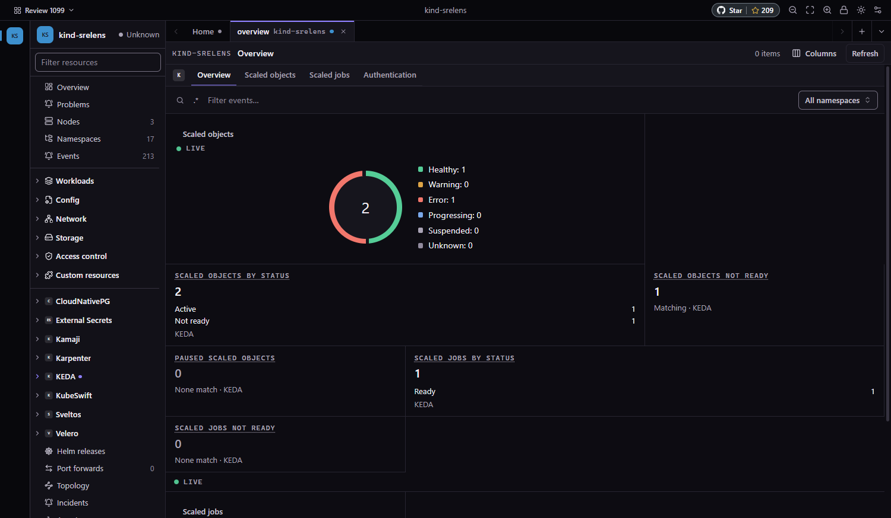

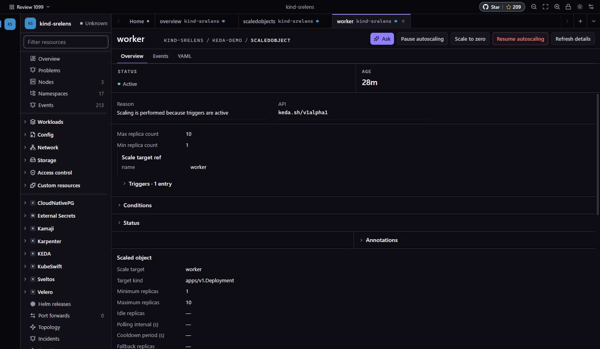

External Secrets

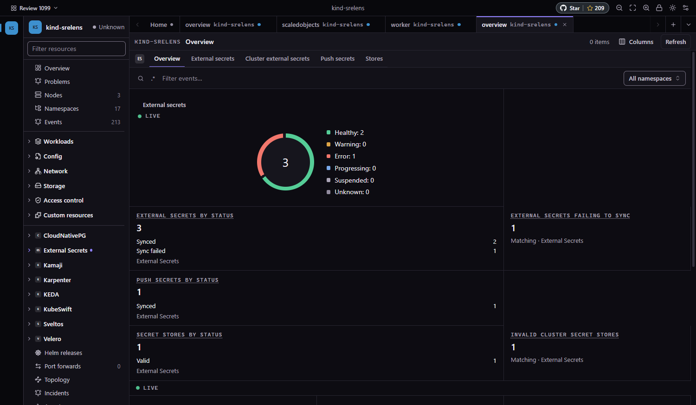

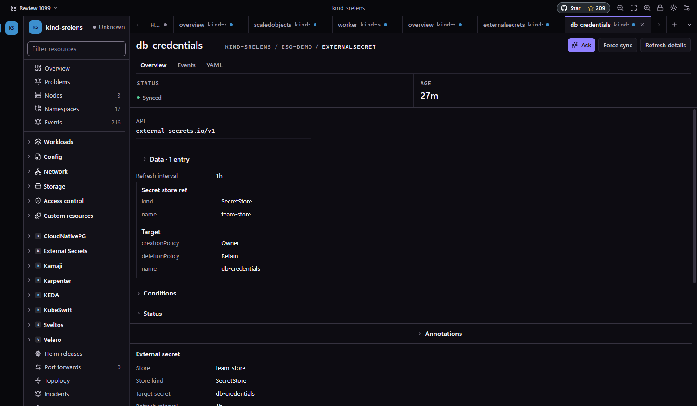

Karpenter

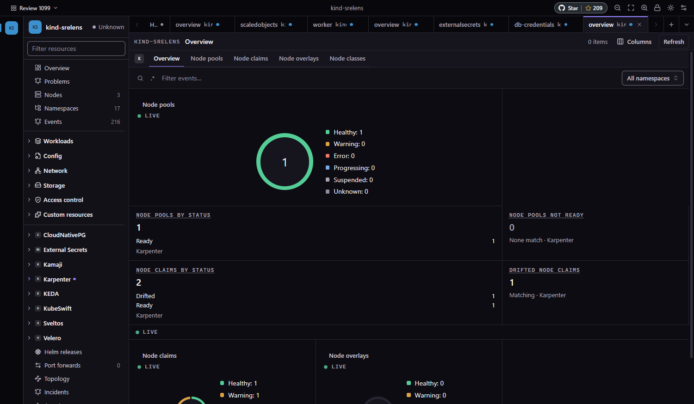

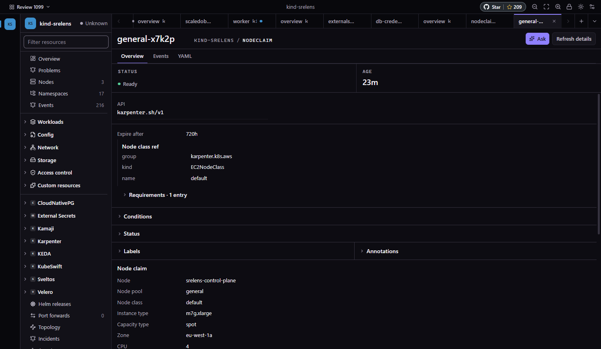

Kamaji

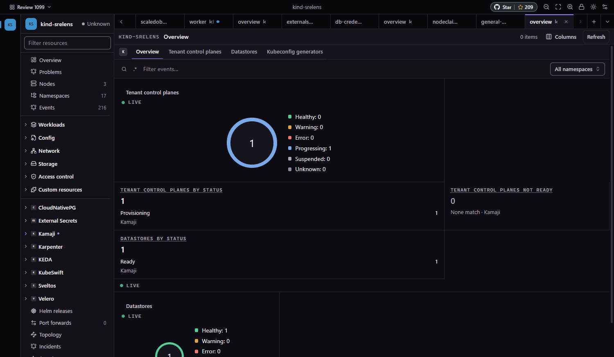

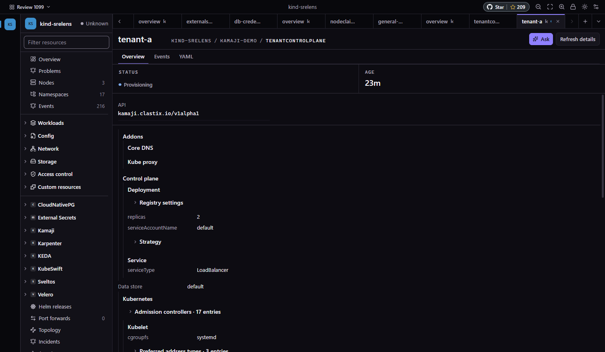

Velero

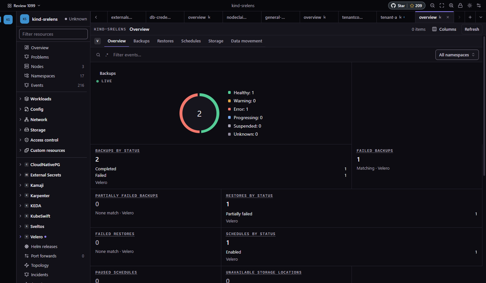

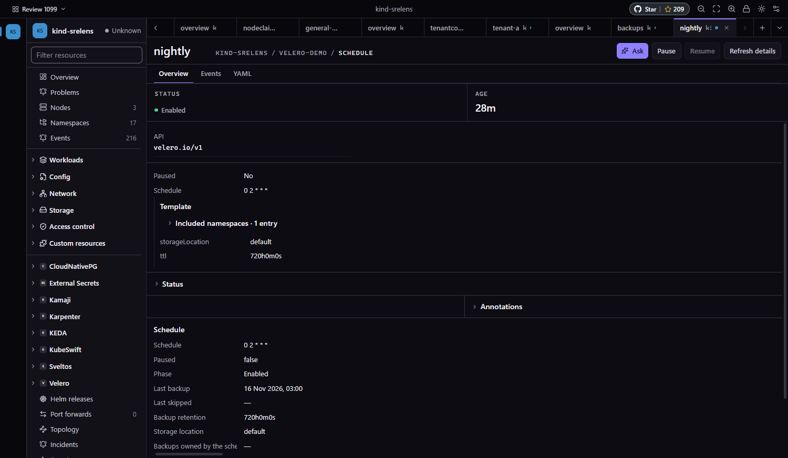

CloudNativePG

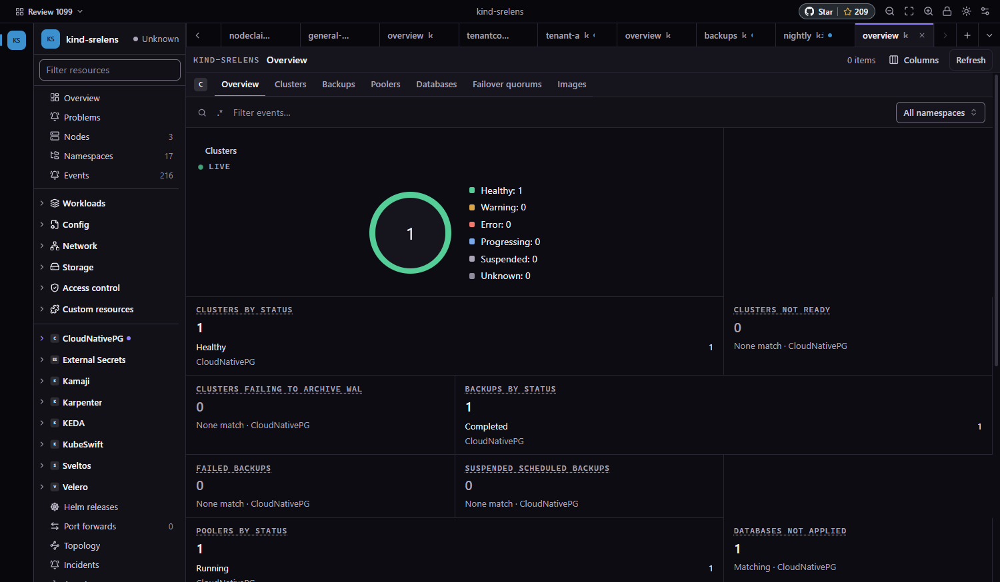

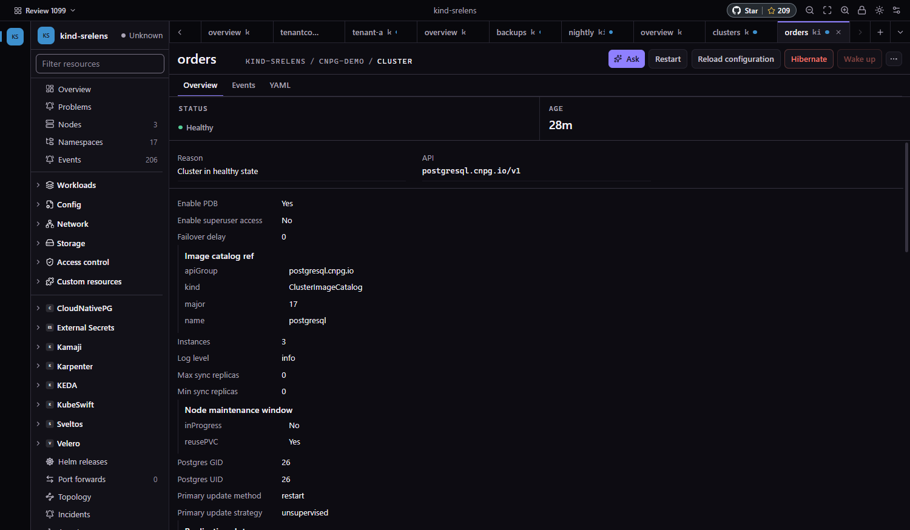

Sveltos

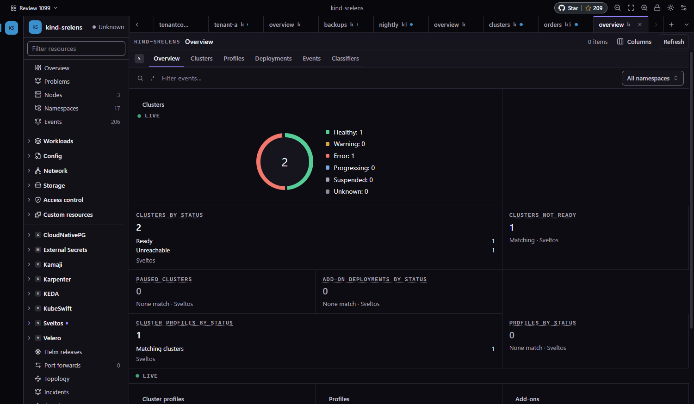

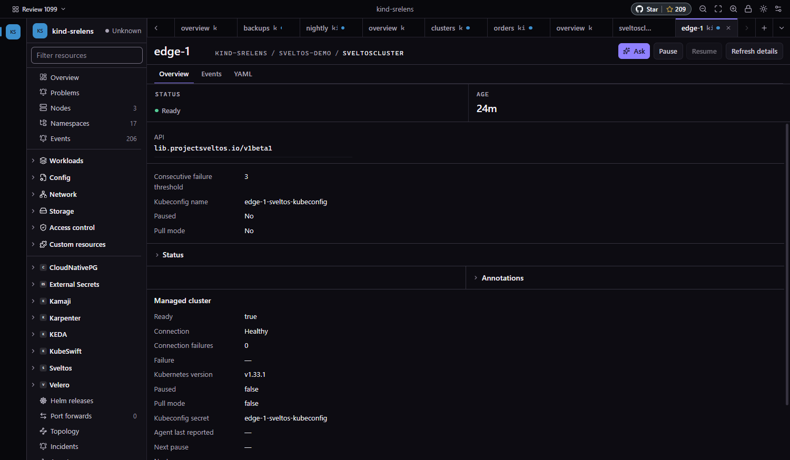

KubeSwift

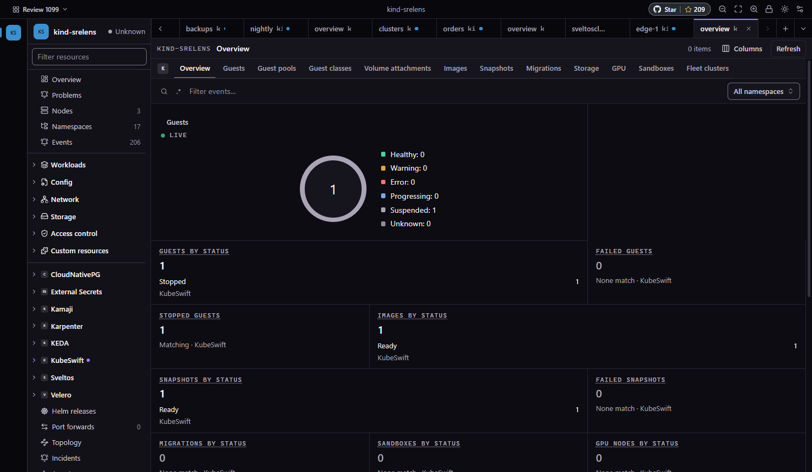

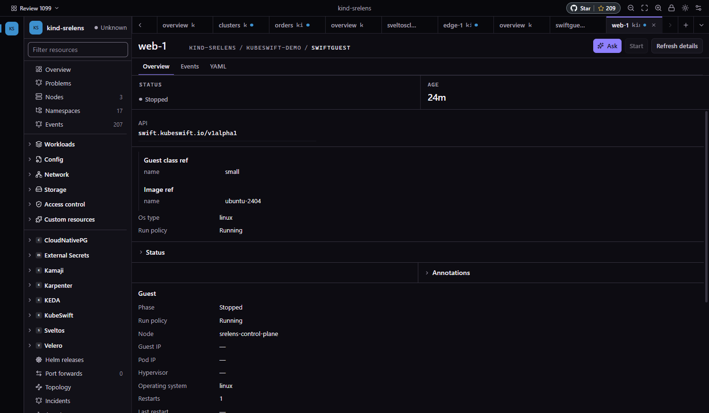

## Providers

| App | What it adds |
|---|---|
| [Prometheus](../../examples/extensions/prometheus.json) | Four metric providers over a Prometheus-compatible endpoint |
| [Loki](../../examples/extensions/loki.json) | Two log providers |
